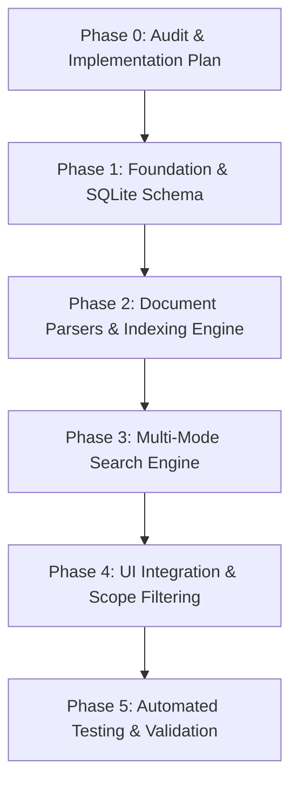

# WeKeepIt V2 — Implementation Plan & Architecture Specification
**Author:** Senior Software Architect & Autonomous Coding Agent  
**Date:** 2026-10-17  
**Status:** Approved / Phase 0 Completed  

---

## 1. Executive Summary

WeKeepIt berevolusi dari aplikasi *Personal Work Board* (V1) menjadi platform *Personal Work Information Board & Local Knowledge Retrieval* (V2). 

V2 menambahkan modul **Document Search** untuk mengindeks dan mencari teks pada koleksi dokumen lokal format **Markdown (`.md`)**, **PDF (`.pdf`)**, **Word (`.docx`)**, dan **Excel (`.xlsx`)** tanpa merusak, mengubah, atau membebani fitur V1.

### Nilai Utama & Batasan Desain
1. **Local-first & Privacy-first**: Seluruh data kartu, pemindaian dokumen, ekstraksi teks, dan mesin pencari berjalan 100% lokal di komputer pengguna tanpa mengirim byte apa pun ke cloud.
2. **Pemisahan Domain yang Tegas**: Dokumen lokal yang diindeks **tidak diubah menjadi kartu Work Board** dan tidak disimpan ke dalam `wekeepit-data.json`. Indeks dokumen dikelola secara mandiri dalam database SQLite lokal (`wekeepit-index.db`).
3. **Pencarian Multi-Mode yang Presisi**:
   - **Mode A (Exact Phrase)**: Mencari kata dengan urutan yang tepat.
   - **Mode B (All Terms, Unordered)**: Mencari semua kata dalam satu unit teks yang sama (kalimat atau paragraf), misalnya pencarian `weekeepit cocok` menemukan kalimat *"WeKeepIt lebih cocok sebagai personal work information board."*
   - **Mode C (Search Scope)**: Filter lingkup pencarian antara `Board`, `Documents`, atau `All`.
4. **Zero Regression V1**: Seluruh fitur V1 (kartu, multi-tag filter `link+role`, metadata dinamis, checklist aktivitas harian, reminder synthesizer, compact/widget mode, dan import/export JSON) tetap berfungsi utuh.

---

## 2. Audit Repository & Analisis Arsitektur Aktual (V1)

Berdasarkan audit mendalam terhadap source code aktual:

### 2.1 Struktur dan Komponen Inti
- **`server.js`**: Server HTTP lokal berbasis modul standar Node.js (`http`, `fs`, `path`). Menyediakan endpoint `/api/cards` (GET/POST) untuk `wekeepit-data.json`, `/api/schema` (GET/POST) untuk `metadata-schema.json`, `/api/ping`, dan serving file statis. Berjalan di port 4321 secara zero-dependency.
- **`app.js`**: Pengontrol antarmuka utama di browser/WebView2 (1.688 baris). Menangani state kartu, filter tab (`all`, `pinned`, `documents`, `reminders`, `checklist`), modal editor kartu, rendering tag bar, export/import JSON, serta integrasi C# WebView2 bridge.
- **`metadata-engine.js`**: Parser query multi-tag yang mendukung sintaks `AND` (`link+role`), `OR` (`link, role`), `#tag`, `tag:name`, dan free text terms, serta resolusi warna tag dinamis.
- **`metadata-schema.json`**: Skema field dinamis (`url`, `role`, `environment`, `priority`, `pic`) dan palet tag kustom.
- **`reminder-service.js`**: Ticker 10 detik, synthesizer chime Web Audio API (nada ganda E5 & A5 tanpa file audio), desktop notification, fungsi snooze (+10m), dan dismiss (auto-advance daily).
- **`document-engine.js` (V1.2)**: Menggunakan library di folder `lib/` (`pdf.min.js`, `mammoth.browser.min.js`, `xlsx.mini.min.js`) untuk mengekstrak teks lampiran kartu sisi browser.
- **`desktop-app/`**: Aplikasi native C# .NET 10 WinForms dengan Microsoft Edge WebView2 (`Form1.cs`). Menangani efek transparansi Acrylic / Mica Windows 11, system tray icon, minimize to tray, dan bridge IPC `window.chrome.webview.postMessage`.
- **Peluncur Desktop**:
  - `launch-desktop.bat`: Memeriksa server lokal di `http://localhost:4321/api/ping`. Jika belum aktif, menjalankan `node server.js` di latar belakang, lalu membuka browser dalam mode app window (`msedge --app=http://localhost:4321`).
  - `launch-silent.vbs`: Wrapper VBScript untuk menjalankan `launch-desktop.bat` tanpa jendela konsol hitam.
  - `WeKeepIt-Portable.bat`: Menjalankan binary standalone `WeKeepIt-v1.2-Portable\WeKeepIt.exe`.

### 2.2 Hubungan Antara HTML/JS, Local Server, dan WinForms App
Audit membuktikan bahwa aplikasi WinForms C# (`Form1.cs`) dan server Node.js (`server.js`) **saat ini berjalan secara independen**:
1. Jika dijalankan via `launch-desktop.bat`, aplikasi menggunakan `server.js` sebagai backend HTTP dan membuka Edge sebagai viewer.
2. Jika dijalankan via `WeKeepIt.exe` (WinForms), WebView2 mengarahkan virtual host `https://wekeepit.local` langsung ke folder aset statis. Komunikasi penyimpanan kartu dilakukan melalui event `postMessage` (`SAVE_CARDS`, `SAVE_SCHEMA`), tanpa memanggil `server.js`.
3. Jika dibuka langsung di browser tanpa server atau C# host, aplikasi beralih ke `localStorage`.

### 2.3 Technical Debt & Risiko yang Ditemukan
1. **Bloat pada JSON Utama (V1.2)**: Pada V1.2, fitur lampiran menyimpan seluruh string Base64 berkas dokumen dan teks hasil ekstraksi langsung ke dalam array kartu di `wekeepit-data.json`. Jika pengguna melampirkan beberapa dokumen berukuran sedang, ukuran JSON membengkak drastis. **V2 memperbaiki ini dengan tidak memasukkan dokumen folder ke JSON kartu**.
2. **Ketiadaan Automated Tests**: Repository belum memiliki automated test suite sama sekali. Risiko regresi pada parsing query, logika reminder, dan format metadata kartu sangat tinggi tanpa harness pengujian otomatis.
3. **Keterbatasan SQLite FTS5 Bawaan Node.js v22**:
   - Pengujian empiris pada lingkungan runtime (`Node.js v22.14.0 x64 Windows`) menunjukkan bahwa modul bawaan `node:sqlite` (`DatabaseSync`) **tidak mengompilasi ekstensi FTS5, FTS4, maupun FTS3** (`Error: no such module: fts5`).
   - Namun, modul `better-sqlite3` terbukti mengemas SQLite 3.46+ lengkap dengan FTS5 aktif secara default, dapat diinstal secara instan (3 detik) via prebuilt binary tanpa memerlukan build tool C++ di komputer pengguna.
   - Selain itu, desain V2 menyiapkan arsitektur fallback table chunk indexing dengan SQLite standar sehingga pencarian Mode A dan Mode B tetap 100% berfungsi bahkan jika runtime tidak memiliki modul FTS5.

---

## 3. Keputusan Teknis & Arsitektur V2

### 3.1 Pilihan Penyimpanan Indeks: SQLite + FTS5
- **File Database**: `wekeepit-index.db` (terpisah total dari `wekeepit-data.json`).
- **Engine**: `better-sqlite3` sebagai engine utama (mendukung FTS5, transaksi cepat, synchronous execution tanpa async callback hell pada SQLite).
- **Skema Terversi & Migrasi Otomatis**: Tabel metadata `schema_migrations` melacak versi skema database (v1, v2, dst.) dan melakukan migrasi idempotent saat server dinyalakan.

### 3.2 Desain Database Schema
```sql
-- Versi skema
CREATE TABLE IF NOT EXISTS schema_migrations (
  version INTEGER PRIMARY KEY,
  applied_at TEXT NOT NULL
);

-- Daftar folder yang diindeks
CREATE TABLE IF NOT EXISTS indexed_folders (
  id TEXT PRIMARY KEY,
  path TEXT UNIQUE NOT NULL,
  recursive INTEGER NOT NULL DEFAULT 1,
  enabled INTEGER NOT NULL DEFAULT 1,
  excluded_patterns TEXT NOT NULL DEFAULT '[]', -- JSON array: [".git", "node_modules", "temp", "*.tmp"]
  created_at TEXT NOT NULL,
  last_scanned_at TEXT
);

-- Metadata file dokumen
CREATE TABLE IF NOT EXISTS documents (
  id TEXT PRIMARY KEY,
  folder_id TEXT NOT NULL,
  path TEXT UNIQUE NOT NULL,
  filename TEXT NOT NULL,
  extension TEXT NOT NULL,
  size INTEGER NOT NULL,
  mtime INTEGER NOT NULL,
  hash TEXT,
  status TEXT NOT NULL, -- 'pending', 'indexing', 'ready', 'failed', 'stale'
  error_message TEXT,
  indexed_at TEXT,
  total_chunks INTEGER NOT NULL DEFAULT 0,
  FOREIGN KEY (folder_id) REFERENCES indexed_folders(id) ON DELETE CASCADE
);

-- Unit indeks teks berbutir halus (sentence / paragraph / page / cell chunk)
CREATE TABLE IF NOT EXISTS document_chunks (
  id TEXT PRIMARY KEY,
  document_id TEXT NOT NULL,
  chunk_index INTEGER NOT NULL,
  location_type TEXT NOT NULL, -- 'page', 'heading_para', 'sheet_cell'
  location_label TEXT NOT NULL, -- e.g. "Hal 3", "Bab 2 > Paragraf 4", "Sheet: Anggaran, Sel: B12"
  content TEXT NOT NULL,
  clean_content TEXT NOT NULL, -- lowercase, normalized punctuation
  FOREIGN KEY (document_id) REFERENCES documents(id) ON DELETE CASCADE
);

-- Tabel Full-Text Search FTS5
CREATE VIRTUAL TABLE IF NOT EXISTS document_chunks_fts USING fts5(
  content,
  location_label,
  filename,
  content='document_chunks',
  content_rowid='rowid'
);
```

### 3.3 Arsitektur Modul Parsers (Adapter Pattern)
Setiap format dokumen diimplementasikan sebagai parser independen dengan kontrak antarmuka yang seragam:
```typescript
interface ExtractedChunk {
  chunkIndex: number;
  locationType: 'page' | 'heading_para' | 'sheet_cell';
  locationLabel: string;
  content: string; // Teks asli per unit kalimat/paragraf/baris
}

interface ParseResult {
  chunks: ExtractedChunk[];
  metadata: {
    pageCount?: number;
    wordCount: number;
    charCount: number;
    isScanned?: boolean;
    ocrNotice?: string;
  };
}
```

1. **Markdown Adapter (`parsers/markdown-parser.js`)**:
   - Membaca baris per baris.
   - Mendeteksi heading (`#`, `##`, `###`) untuk membentuk konteks breadcrumb lokasi (misal: `Heading: Spesifikasi > Paragraf 2`).
   - Memecah teks ke dalam kalimat/paragraf dengan nomor paragraf yang tepat tanpa mengarang nomor halaman.
2. **PDF Adapter (`parsers/pdf-parser.js`)**:
   - Membaca stream per halaman menggunakan PDF.js engine.
   - Menyimpan lokasi berupa nomor halaman asli (`Hal 1`, `Hal 2`, ...).
   - Menghitung rasio karakter terhadap halaman untuk mendeteksi PDF scan gambar; jika teks kosong pada seluruh halaman, menandai dokumen dengan status `isScanned: true` dan menyertakan keterangan `OCR belum tersedia`.
3. **Word Adapter (`parsers/docx-parser.js`)**:
   - Membaca dokumen DOCX (arsip OpenXML).
   - Mengekstrak heading style (`Heading 1`, `Heading 2`), paragraf reguler, dan teks dari tabel (`<w:tbl>`).
   - Menyimpan lokasi sebagai `Heading: [Judul] > Paragraf [N]` atau `Tabel [X], Baris [Y]`. Tidak mengarang nomor halaman yang tidak ada.
4. **Excel Adapter (`parsers/xlsx-parser.js`)**:
   - Membaca sheet aktif dan non-hidden menggunakan parser SheetJS.
   - Mengekstrak sel yang berisi teks atau nilai string.
   - Menyimpan lokasi akurat: `Sheet: [NamaSheet], Sel: [KolomBaris]` (contoh: `Sheet: Timeline, Sel: C14`).
   - Mengabaikan formula berbahaya, macro, atau konten aktif demi keamanan.

### 3.4 Desain Mesin Pencari (Search Engine)
- **Normalisasi Teks**: Mengubah teks menjadi lowercase, menormalkan spasi ganda, tanda baca standar, dan karakter Unicode (NFKC).
- **Mode A — Exact Phrase**:
  - Menggunakan pencocokan frasa verbatim (FTS5 `MATCH '"personal work board"'`).
- **Mode B — All Terms, Unordered**:
  - Query contoh: `weekeepit cocok`.
  - Syarat wajib: **semua kata wajib berada di dalam satu unit teks yang sama** (chunk paragraf atau kalimat).
  - Algoritma pencocokan memeriksa apakah setiap kata dalam query muncul dalam chunk yang sama. Jika muncul di chunk/halaman yang berbeda, hasil tidak dianggap cocok.
- **Smart Snippet & Context Window**:
  - Menemukan posisi kata kunci dalam chunk.
  - Mengambil kalimat pembungkus (~120 karakter sebelum dan ~180 karakter sesudah).
  - Memberikan tag `<mark class="search-highlight">` pada kata yang cocok.
- **Mode C — Scope Filter**:
  - `Board`: Hanya mencari kartu catatan V1.
  - `Documents`: Hanya mencari dokumen lokal yang diindeks.
  - `All`: Menampilkan hasil terpadu atau tersegmentasi.

### 3.5 Manajemen Folder & Incremental Indexing
- **Penambahan Folder**: Pengguna memilih folder melalui dialog pemilihan atau input path.
- **Exclude Rules**: Default mengabaikan folder sistem dan folder pengembang seperti `.git`, `node_modules`, `bin`, `obj`, `.vs`, `.gemini`, `AppData`.
- **Incremental Reconciliation**:
  - Sebelum membaca isi berkas, engine memeriksa `mtime` (modified time) dan ukuran berkas (`size`).
  - Jika `mtime` dan `size` identik dengan metadata di database, berkas dilewati (*skipped / zero-overhead*).
  - Jika `mtime` berubah, hanya berkas tersebut yang diparsing ulang dan chunk lamanya diganti secara transaksional (`atomic update`).
  - File yang dihapus di filesystem otomatis dihapus dari tabel dokumen dan chunk (`cascade delete`).
- **Filesystem Watcher & Fallback**:
  - `fs.watch` mendeteksi penambahan, modifikasi, dan penghapusan berkas secara real-time.
  - Pemindaian rekonsiliasi manual (*Reindex*) tetap tersedia melalui antarmuka pengguna sebagai fallback andal.

---

## 4. Rencana Integrasi UI (Ringan, Elegan, dan Responsif)

Antarmuka pengguna tetap menjaga filosofi WeKeepIt: **ringan, cepat, modern, tidak bloated**.

### 4.1 Navigasi Utama
Navigasi tab atas diperluas secara natural:
- 📋 **Board** (Work Board V1: Catatan, Pin, Reminder, Checklist).
- 📁 **Documents** (Manajemen folder terindeks, status scanning/indexing, daftar berkas terindeks, tombol reindex manual).
- 🔍 **Search** (Panel pencarian global dengan scope filter: `Semua`, `Board`, `Dokumen`).

### 4.2 Komponen UI Baru untuk Dokumen & Pencarian
1. **Search Scope Selector**: Toggle rapi di samping search input (`Board`, `Dokumen`, `Semua`).
2. **Library Folder Manager View**:
   - Kartu/tabel daftar folder yang diindeks dengan status badge (*Aktif*, *Memproses...*, *Selesai*, *Error*).
   - Form penambahan folder dengan opsi *Pindai Subfolder* dan aturan pengecualian.
   - Status bar progres indexing (misal: *Mengindeks 12/48 berkas...*).
3. **Document Search Result Cards**:
   - Judul berkas dan path lengkap yang dapat diklik untuk membuka file via aplikasi default OS (`shell.openPath` / system launcher).
   - Badge tipe file berwarna (PDF merah, Word biru, Excel hijau, MD ungu).
   - Badge lokasi sumber yang presisi (`📄 Hal 4`, `📑 Heading: Fitur > Paragraf 2`, `📊 Sheet: Rekap, Sel: D15`).
   - Snippet teks dengan kata kunci berhighlight kuning terang.
   - Tombol aksi: **Buka Berkas** dan **Tampilkan di Folder**.

---

## 5. Rencana Pengujian Otomatis (Automated Test Suite)

Dibuat menggunakan runner bawaan Node.js (`node --test`), tanpa dependensi pengujian eksternal:

| Modul Uji | Cakupan Pengujian |
|---|---|
| `test/v1-regression.test.js` | Parsing query tag V1 (`link+role`, `link, role`), filtering kartu, reminder due time, format countdown, skema metadata dinamis. |
| `test/parsers.test.js` | Ekstraksi format `.md`, `.pdf`, `.docx`, `.xlsx` menggunakan fixture dokumen kecil terstandar; verifikasi akurasi lokasi sumber (halaman, heading, cell). |
| `test/search-engine.test.js` | Mode A (exact phrase), Mode B (all terms unordered pada unit kalimat yang sama), verifikasi kegagalan pencocokan jika kata tersebar di paragraf berbeda, highlight snippet. |
| `test/incremental-index.test.js` | Deteksi file baru, file termodifikasi, file dihapus, file terabaikan (exclude pattern), dan idempotency scan. |
| `test/database-migration.test.js` | Inisialisasi skema SQLite, migrasi versi, integritas referensial foreign key, dan isolasi data V1. |

---

## 6. Tahapan Implementasi Terinci



### Phase 0 — Audit & Implementation Plan *(Selesai)*
- Analisis mendalam kode sumber aktual.
- Verifikasi empiris SQLite FTS5 dan lingkungan runtime.
- Penyusunan `docs/V2-IMPLEMENTATION-PLAN.md`.

### Phase 1 — Fondasi & Skema Database
- Konfigurasi `package.json` untuk menyertakan `better-sqlite3` dan script test.
- Pembuatan modul `indexer/db.js` untuk inisialisasi skema database SQLite, tabel migrasi, dan isolasi file `wekeepit-index.db`.
- Pembuatan modul `indexer/folder-manager.js` untuk manajemen folder, konfigurasi exclude list, dan pemindaian rekursif.
- Pembuatan endpoint REST API di `server.js` untuk folder dan status indexer.
- Verifikasi bahwa data V1 tetap berjalan tanpa perubahan.

### Phase 2 — Document Parsers & Incremental Indexing
- Implementasi parser individual:
  - `parsers/markdown-parser.js`
  - `parsers/pdf-parser.js`
  - `parsers/docx-parser.js`
  - `parsers/xlsx-parser.js`
- Implementasi `indexer/document-indexer.js`:
  - Rekonsiliasi berkas (hash, mtime, size).
  - Ekstraksi chunk teks dan penyimpanan ke tabel `document_chunks` & `document_chunks_fts`.
  - Background queue dan status reporting non-blocking.
  - Safe error handling: kegagalan satu berkas korup tidak membatalkan indexing berkas lain.

### Phase 3 — Multi-Mode Search Engine
- Implementasi `indexer/search-engine.js`:
  - Mode A (Exact phrase search).
  - Mode B (All terms, unordered search pada unit chunk yang sama).
  - Ekstraksi snippet dan pembuatan highlight `<mark>`.
  - Pengurutan relevansi hasil (skor match, posisi heading, nama file).
- Integrasi endpoint `/api/search` dan `/api/open-file`.

### Phase 4 — Integrasi Antarmuka Pengguna (UI)
- Penambahan navigasi tab `Board`, `Documents`, dan `Search` di `index.html`.
- Penambahan scope filter (`Board`, `Dokumen`, `Semua`) pada search bar.
- Pembuatan view dokumen: manajemen folder, daftar berkas terindeks, progress bar status, dan tombol reindex.
- Pembuatan view hasil pencarian dokumen dengan informasi nama file, lokasi sumber, snippet highlight, dan tombol buka file.
- Penyesuaian styling di `style.css` agar konsisten dengan tema dark & acrylic V1.

### Phase 5 — Validasi, Benchmark & Dokumentasi
- Pembuatan test fixtures dokumen (`.md`, `.pdf`, `.docx`, `.xlsx`).
- Menjalankan seluruh unit test dan regression test V1 (`npm test`).
- Benchmark pemindaian dan pencarian pada koleksi file realistis.
- Pembaruan `README.md` dan panduan penggunaan V2.

---

## 7. Rencana Manajemen Risiko & Mitigasi

| Risiko | Dampak | Strategi Mitigasi |
|---|---|---|
| **Data V1 terganggu / korup** | Kritis | Data V1 disimpan di `wekeepit-data.json`, sedangkan indeks V2 di `wekeepit-index.db`. Tidak ada operasi penulisan silang antar kedua penyimpanan. |
| **File dokumen besar membuat UI freeze** | Tinggi | Proses pemindaian dan parsing berjalan di background server Node.js secara asynchronous dengan batch queue; UI menerima update status via polling/SSE ringan. |
| **Ekstraksi teks gagal pada dokumen korup / terproteksi password** | Sedang | Setiap parser dibungkus blok `try-catch` terisolasi. Status dokumen ditandai `failed` dengan pesan error yang jelas, tanpa menghentikan pemrosesan dokumen lain. |
| **Dokumen berpindah atau dihapus dari disk** | Rendah | Pemindaian rekonsiliasi memeriksa keberadaan file di disk; entri yang hilang ditandai `stale` atau dibersihkan secara otomatis. |
| **Runtime pengguna tanpa compiler C++** | Sedang | `better-sqlite3` menggunakan precompiled binary untuk Windows x64. Modul DB juga dirancang dengan fallback database schema agar sistem tetap andal. |

---

## 8. Definition of Done (Kriteria Keberhasilan V2)

1. [x] **Phase 0 Audit selesai**: Analisis kode, uji empiris FTS5, dan rencana implementasi terdokumentasi lengkap.
2. [ ] Seluruh fitur Work Board V1 tetap bekerja 100% tanpa regresi.
3. [ ] Pengguna dapat menambahkan folder, mengatur exclude list, dan mengindeks file rekursif.
4. [ ] Format `.md`, `.pdf`, `.docx`, dan `.xlsx` dapat diekstrak dan dicari teksnya.
5. [ ] Query `weekeepit cocok` menemukan kalimat "WeKeepIt lebih cocok sebagai personal work information board." dalam unit kalimat/paragraf yang sama (Mode B).
6. [ ] Mode A (Exact phrase) berfungsi akurat.
7. [ ] Hasil pencarian menyajikan nama file, path, cuplikan snippet dengan highlight, dan lokasi sumber (halaman PDF, heading/paragraf DOCX/MD, sheet/sel XLSX).
8. [ ] Pengguna dapat membuka berkas langsung dari hasil pencarian.
9. [ ] Pembaruan berkas terdeteksi secara inkremental tanpa memproses ulang seluruh folder.
10. [ ] Automated test suite berjalan dan lulus 100%.
11. [ ] Dokumentasi dan instruksi operasional diperbarui.
